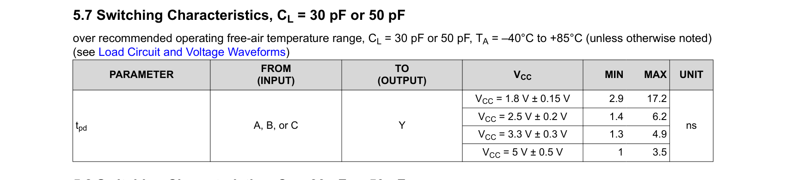
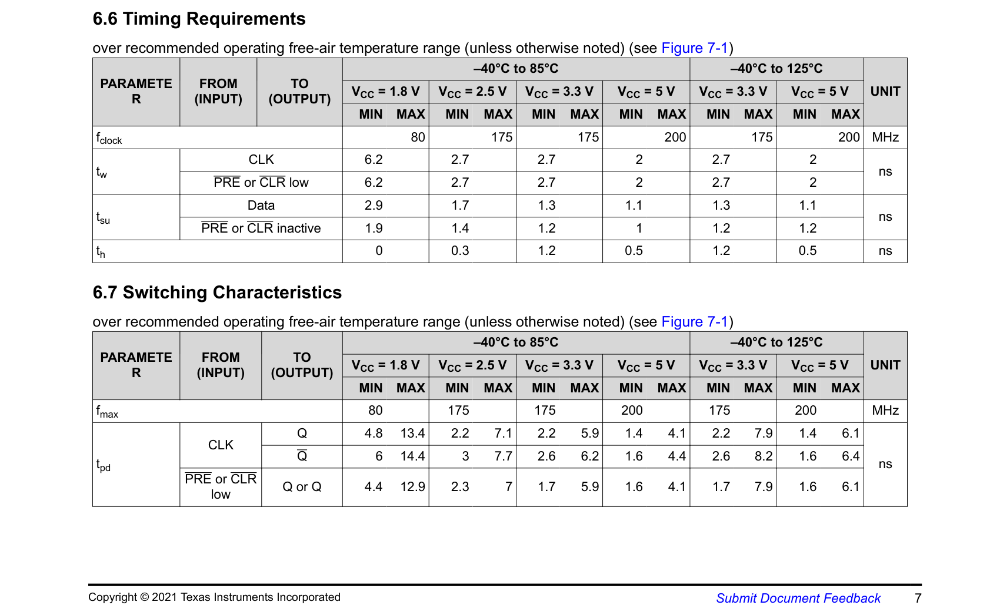

# Timing — tramo FF a FF entre PinChecker (Mealy) y LockController (Moore)

## 1. Qué tramo elegí y por qué

De las dos FSM de [C3](../../C3) (mi P2: `PinChecker` Mealy y `LockController` Moore), tomo el
tramo que ya había identificado como el más interesante del diseño en
[`C3/docs/04-verificacion.md`](../../C3/docs/04-verificacion.md): el cruce de `match` desde
`PinChecker` hacia el bit `Q2` de `LockController` (el bit que directamente activa `unlock`).
Es el tramo donde se ve el efecto Mealy-vs-Moore (ver el diagrama de tiempo que ya tenía en
`C3/img/timing_pin_lock.png`), y además es el camino real de un PIN correcto abriendo la
cerradura, no un caso de borde.

Circuito, con `Q1` saliendo de un flip-flop de `PinChecker` como origen y `Q2` de
`LockController` como destino:

```
FF_Q1 (PinChecker) ──┐
                      AND3 (match = D·Q1·Q0) ──┐
FF_Q0 (PinChecker) ──┘                          AND3 (M·Q0'·Q2') ──┐
                                                                     OR2 ──┐
                                      (Q2' por realimentación) ────┘      OR2 ── D de FF_Q2 (LockController)
                                              (Q2·L' por realimentación) ─┘
```

Tomo específicamente el arranque desde `Locked0` (`Q2=Q1=Q0=0`), que es el caso de "primer
intento, PIN correcto": ahí la ecuación completa de `N2` (de
[`C3/docs/03-lock-controller-moore.md`](../../C3/docs/03-lock-controller-moore.md)),

$$N_2 = Q_2\overline{L} + M\overline{Q_0}\,\overline{Q_2} + M\overline{Q_1}\,\overline{Q_2}$$

tiene su término `Q2·L'` en 0 (porque `Q2=0`), así que lo que realmente determina `N2` es la
rama que depende de `M` (`match`). El camino combinacional de compuertas reales que atraviesa
la señal, de `FF_Q1` hasta la entrada `D` de `FF_Q2`, es:

1. **AND3** — `match = D · Q1 · Q0`
2. **AND3** — un término de `N2` (`M · Q0' · Q2'`)
3. **OR2** — primera etapa de la OR de 3 entradas de `N2`
4. **OR2** — segunda etapa (TI no fabrica una OR de 3 entradas de un solo gate en esta
   familia de bajo voltaje, igual que noté en C2 con la compuerta de 3 entradas del
   circuito SOP — se arma con 2 OR2 en cascada)

Son 4 compuertas en serie entre los dos flip-flops, un tramo comparable en profundidad al
camino crítico que ya había analizado en C2 (ahí era NOT + 2×OR + AND).

## 2. Compuertas y flip-flop reales (Digikey, familia 74LVC de TI a 1.8V)

Mismo criterio que en C2: familia **74LVC** de Texas Instruments, porque opera de 1.65V a
5.5V (1.8V queda cómodo dentro del rango) y viene en SOT-23 de un solo gate, ideal para
replicar compuerta por compuerta el esquemático discreto.

| Función | Parte | Empaquetado | Digikey / TI |
|---|---|---|---|
| AND de 3 entradas (×2, para `match` y el término de `N2`) | SN74LVC1G11 | SOT-23-6 (DBV) | [ti.com/lit/ds/symlink/sn74lvc1g11.pdf](https://www.ti.com/lit/ds/symlink/sn74lvc1g11.pdf) |
| OR de 2 entradas (×2, cascada para la OR de 3 entradas de `N2`) | SN74LVC1G32 | SOT-23-5 (DBV) | mismo part number usado en C2, [ti.com/lit/ds/symlink/sn74lvc1g32.pdf](https://www.ti.com/lit/ds/symlink/sn74lvc1g32.pdf) |
| Flip-flop D con reset asíncrono | SN74LVC1G74 | SSOP/VSSOP 8 pines (DCT/DCU) | [ti.com/lit/ds/symlink/sn74lvc1g74.pdf](https://www.ti.com/lit/ds/symlink/sn74lvc1g74.pdf) |

El SN74LVC1G74 es un flip-flop D con `PRE` y `CLR` asíncronos (activos en bajo) — uso `CLR`
para el `Reset` global del diseño, que es exactamente la misma función que en Logisim
(`Reset` al pin R de cada flip-flop). Las tres partes están activas en producción (verificado
en las páginas de producto de TI, octubre 2026) y pertenecen a la misma familia/proceso que
usé en C2, así que comparten las mismas condiciones de `VIH`/`VIL` a 1.8V.

## 3. Tiempos reales de datasheet (VCC = 1.8V ± 0.15V)

Capturas de las tablas de *Switching Characteristics* / *Timing Requirements*, condición
`CL = 30pF o 50pF` (la misma condición de carga que usé en C2, más representativa de una
pista real que la de 15pF):





| Parámetro | Compuerta/FF | Mín (ns) | Máx (ns) |
|---|---|---|---|
| t_pd (AND3) | SN74LVC1G11 | 2.9 | 17.2 |
| t_pd (OR2) | SN74LVC1G32 | 2.8 | 8.0 |
| t_clk-to-Q | SN74LVC1G74 | 4.8 | 13.4 |
| t_setup (dato D) | SN74LVC1G74 | 2.9 (requerido) | — |
| t_hold (dato D) | SN74LVC1G74 | 0 (requerido) | — |

(El OR2 reusa los mismos valores que documenté en
[`C2/docs/2.28-digikey-nm-timing.md`](../../C2/docs/2.28-digikey-nm-timing.md), porque es el
mismo part number, misma condición de VCC y de carga.)

## 4. Cálculo — setup y Fc

**Qué es la restricción de setup:** el dato que llega a la entrada `D` del flip-flop
destino (`FF_Q2`) tiene que haber "terminado de viajar" por toda la lógica combinacional, y
quedarse estable, *antes* de que llegue el siguiente flanco de reloj (con el margen del
`t_setup` del flip-flop). Eso fija el período de reloj mínimo y, con eso, la frecuencia
máxima real `Fc`.

Supuestos: skew de reloj = 0 (mismo `CLK` para ambas FSM, sin red de distribución de reloj
real que modelar), y tomo siempre el **máximo** de cada etapa porque es el peor caso.

$$t_{pd,lógica,max} = t_{pd,AND3,max} + t_{pd,AND3,max} + t_{pd,OR2,max} + t_{pd,OR2,max}$$
$$t_{pd,lógica,max} = 17.2 + 17.2 + 8.0 + 8.0 = 50.4\text{ ns}$$

$$T_{clk} \geq t_{clk\text{-}to\text{-}Q,max} + t_{pd,lógica,max} + t_{setup}$$
$$T_{clk} \geq 13.4 + 50.4 + 2.9 = 66.7\text{ ns}$$

$$F_c = \frac{1}{T_{clk}} = \frac{1}{66.7\text{ ns}} \approx 14.99\text{ MHz} \approx 15.0\text{ MHz}$$

## 5. Cálculo — hold

**Qué es la restricción de hold:** después del flanco de reloj, el dato en `D` tiene que
quedarse estable un ratito más (`t_hold`) para que el flip-flop lo capture bien. Acá el
riesgo es el camino **más rápido** (el de menor retardo), porque si la lógica cambia
demasiado rápido después del flanco, puede "pisar" el dato antes de que el flip-flop termine
de capturarlo. Por eso esta vez se usan los tiempos **mínimos** de las mismas compuertas del
tramo.

$$t_{cd,lógica,min} = t_{pd,AND3,min} + t_{pd,AND3,min} + t_{pd,OR2,min} + t_{pd,OR2,min}$$
$$t_{cd,lógica,min} = 2.9 + 2.9 + 2.8 + 2.8 = 11.4\text{ ns}$$

$$t_{clk\text{-}to\text{-}Q,min} + t_{cd,lógica,min} \geq t_{hold}$$
$$4.8 + 11.4 = 16.2\text{ ns} \geq 0\text{ ns} \quad\checkmark\text{ se cumple, con 16.2 ns de margen}$$

El hold se cumple con margen amplio porque el flip-flop SN74LVC1G74 pide `t_hold = 0 ns` a
1.8V — no hay riesgo de violación de hold en este tramo con compuertas reales de esta
familia.

## 6. Verificación aritmética

Repetí ambos cálculos con un script en Python, usando los mismos números de las tablas de
arriba, antes de pasarlos a este documento (no están en el repo porque son solo una
calculadora, igual que hice en C3 con sympy):

```
=== Setup constraint ===
t_pd,logic,max = 17.2 + 17.2 + 8.0 + 8.0 = 50.4 ns
T_clk >= 13.4 + 50.4 + 2.9 = 66.7 ns
Fc = 1 / 66.7ns = 14.993 MHz

=== Hold constraint ===
t_cd,logic,min = 2.9 + 2.9 + 2.8 + 2.8 = 11.4 ns
4.8 + 11.4 = 16.2 ns  >=  0.0 ns ?  CUMPLE
Margen de hold = 16.2 ns
```

## 7. Comparación con la implementación en la Basys3

La Basys3 corre a 100 MHz (10 ns de período), muy por encima de los 66.7 ns que pide este
tramo discreto — por eso en la FPGA no uso el reloj de 100MHz directo para las FSM: lo bajo
con un divisor/antirrebote y avanzo la máquina un paso por botón, no a la velocidad máxima
del reloj de la placa (ver [`02-hdl.md`](02-hdl.md)). El número de 14.99 MHz es el límite
real si este mismo diseño se armara con las 5 compuertas discretas (2× AND3, 2× OR2, y los 2
flip-flops en los extremos) en una placa, no un límite de la FPGA en sí — dentro de la
FPGA, la síntesis mapea esta misma lógica a LUTs, que tienen retardos muy distintos a los de
estas compuertas comerciales (retomo esto con datos reales de mis reportes de Vivado en
[`03-vivado.md`](03-vivado.md)).
