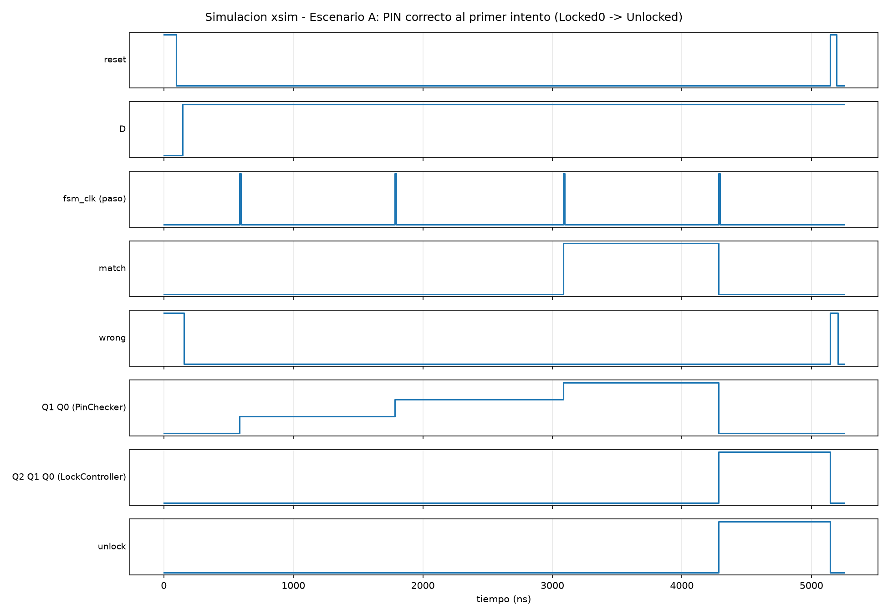

# HDL — de compuertas discretas a SystemVerilog

## 1. Jerarquía y por qué la organicé así

El PDF pide mínimo 3 archivos (`top.sv` instanciando `mealy.sv` y `moore.sv`), pero la
Basys3 necesita dos cosas más que no existen en el diseño discreto de C3: un reloj de
100MHz hay que convertirlo en algo que yo pueda controlar paso a paso, y un botón físico
rebota. Decidí sacar eso a dos módulos aparte en vez de meterlo dentro de `top.sv`:

```
src/
  mealy.sv        PinChecker (FSM Mealy)
  moore.sv        LockController (FSM Moore)
  clk_divider.sv  divide los 100MHz a una tasa de muestreo manejable
  debounce.sv     antirrebote + detector de flanco, sobre esa tasa de muestreo
  top.sv          instancia los 4 anteriores y mapea a los pines de la Basys3
```

La jerarquía que pide el PDF (`top` → `mealy`, `moore`) se mantiene intacta — `clk_divider`
y `debounce` son auxiliares de la interfaz física, no parte de la lógica de la cerradura.
Los separé en archivos propios porque cada uno tiene una responsabilidad clara y así
`mealy.sv`/`moore.sv` quedan exactamente como el ejemplo del profesor (sin lógica de la
placa mezclada adentro), y porque `debounce.sv` depende de `clk_divider.sv` pero no al
revés — separarlos deja esa dependencia explícita en vez de un solo archivo largo.

## 2. Por qué divisor de reloj Y antirrebote (no solo uno)

El antirrebote no puede muestrear el botón a los 100MHz directos: necesitaría contadores
enormes para filtrar unos pocos milisegundos de rebote mecánico. `clk_divider` baja esa
tasa a un "tick" de muestreo (parametrizado, 1kHz en la placa real) que usa `debounce`
para decidir si el nivel del botón ya se mantuvo estable varias muestras seguidas. Recién
ahí, un detector de flanco de subida convierte ese nivel ya limpio en un pulso de exactamente
un ciclo de `clk100mhz` — ese pulso es el "reloj manual" (`fsm_clk`) que ven `mealy` y
`moore`. Es el mismo principio que `clck_psc.sv` del profesor (un contador que genera un
tick), llevado un paso más allá porque yo necesito un pulso por apretón de botón, no un
reloj lento que corre solo.

`DEBOUNCE_SAMPLE_COUNT` y `DEBOUNCE_STABLE_SAMPLES` quedan como parámetros de `top` para
poder simular en microsegundos en vez de milisegundos (ver `sim/testbench.sv`) sin tocar
una sola línea de lógica — en la síntesis real uso los valores por defecto (1kHz de
muestreo, 8 muestras estables).

## 3. Mismas ecuaciones, misma codificación que C3

`mealy.sv` y `moore.sv` no reinterpretan el diseño: implementan exactamente las tablas de
transición y la codificación de estados de
[`C3/docs/02-pin-checker-mealy.md`](../../C3/docs/02-pin-checker-mealy.md) y
[`C3/docs/03-lock-controller-moore.md`](../../C3/docs/03-lock-controller-moore.md)
(`S0=00, S1=01, S2=10, S3=11` para PinChecker; `Locked0=000 ... Unlocked=100` para
LockController), con un `case` por estado en vez de las ecuaciones booleanas ya
minimizadas — es el mismo comportamiento, descrito al nivel de la tabla de transición en
vez de al nivel de compuerta, que es justo lo que hace la síntesis con cualquiera de las
dos formas (ver [`03-vivado.md`](03-vivado.md)).

Separación de bloques en los dos módulos, igual que el ejemplo del profesor:

- **Registro de estado** (`always_ff @(posedge clk, posedge reset)`): un solo flip-flop
  lógico por FSM, reset asíncrono a `S0`/`Locked0`, igual que el pin R de los flip-flops D
  en el circuito de Logisim.
- **Lógica de siguiente estado** (`always_comb` con `case`): puramente combinacional,
  nunca se le asigna un flip-flop propio.
- **Lógica de salida** (`assign`): en `mealy.sv` depende de estado *y* entrada (Mealy); en
  `moore.sv` depende solo del estado (Moore) — la misma distinción que motivó elegir una
  FSM Mealy y otra Moore en C3.

Cada módulo expone además `state_bits` (los bits `Q` crudos) como salida, solo para poder
verlos en los LEDs de debug de la Basys3 — no participan de la lógica de ninguna FSM.

## 4. Testbench

[`sim/testbench.sv`](../sim/testbench.sv) instancia `top` completo (no las FSM sueltas),
así que también ejercita `clk_divider` y `debounce` reales. Simula presionando y soltando
`btn_step` el tiempo que el antirrebote necesita para registrar un flanco limpio, usando
parámetros de debounce chicos (10 ciclos de muestreo, 4 muestras estables) para no
simular milisegundos reales de rebote.

Cubre, con 35 chequeos auto-verificados (PASS/FAIL comparando contra las tablas de C3):

- Las 8 filas de la tabla de transición de `PinChecker` (los 4 estados × `D=0`/`D=1`).
- Las 12 combinaciones relevantes de `LockController` (`match`/`wrong`/sin cambio desde
  cada uno de los 3 estados `Locked*`, más `Alarm` y `Unlocked`).
- Los 4 escenarios de [`C3/tests/`](../../C3/tests): PIN correcto al primer intento, 1 y 2
  fallos antes de un PIN correcto, 3 fallos seguidos hasta `Alarm`, `Alarm` ignorando un
  PIN correcto, y que solo el `Reset` global saca de `Alarm`.
- `Unlocked` → `Locked0` con `L=1` (y que **no** vuelve a `Locked2` — cada intento nuevo
  empieza limpio, mismo criterio de diseño que en C3).

Corrida real (`xvlog` + `xelab` + `xsim`, línea de comandos, sin abrir la GUI de Vivado):

```
PASS - A0 - reset: Locked0, S0
...
PASS - G3 - Unlocked, L=1: vuelve a Locked0 (no Locked2)

==================================================
RESULTADO: 35 PASS, 0 FAIL
TESTBENCH: PASS
==================================================
```

Sin warnings de `xvlog`/`xelab`/`xsim`. Waveform real de la simulación (escenario "PIN
correcto al primer intento"), generada a partir de un VCD porque no renderizo la GUI del
simulador por línea de comandos — se ve exactamente el mismo efecto de un ciclo de retraso
entre `match` (Mealy) y `unlock` (Moore) que ya había documentado en C3:


